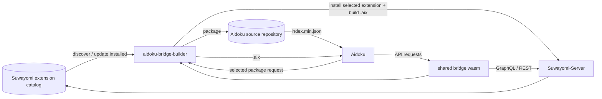
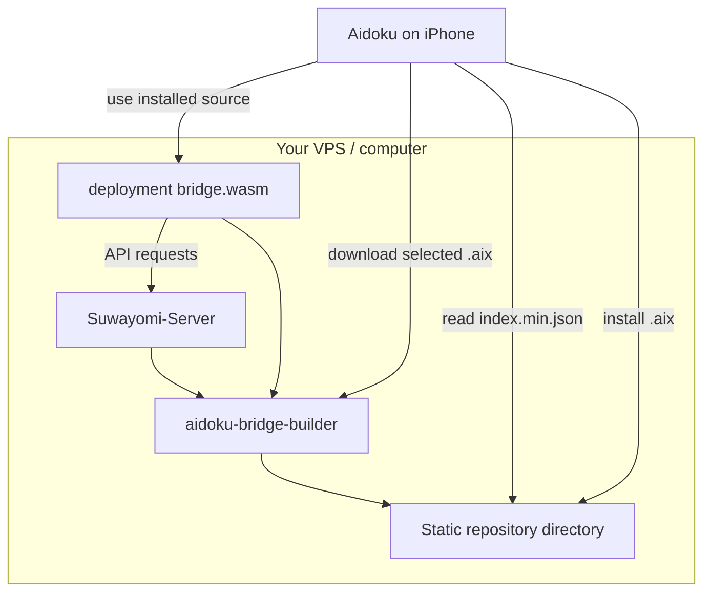

<h1 align="center">aidoku-bridge-builder</h1>

<p align="center">
  Automated builder and repository generator that exposes a <a href="https://github.com/Suwayomi/Suwayomi-Server">Suwayomi-Server</a> extension catalog to <a href="https://aidoku.app">Aidoku</a> as installable <code>.aix</code> sources.
  <br>
  Heavy lifting in Suwayomi. Lightweight adaptation in the bridge.
</p>

<p align="center">
  <a href="https://github.com/TaisenDev/aidoku-bridge-builder/releases"></a>
  <a href="https://github.com/TaisenDev/aidoku-bridge-builder/commits"></a>
  <a href="https://github.com/TaisenDev/aidoku-bridge-builder/issues"></a>
  <a href="https://github.com/TaisenDev/aidoku-bridge-builder/stargazers"></a>
</p>

## What is this?

`aidoku-bridge-builder` turns Suwayomi's full extension catalog into an Aidoku repository without installing every extension on the server. It installs a catalog-listed extension only when Aidoku requests its package.

The goal is to avoid rewriting or maintaining the same source logic twice.

Suwayomi already knows how to discover, install, and execute Mihon/Tachiyomi-compatible extensions. The builder publishes catalog metadata for all matching extensions, then combines a selected extension's source metadata with one deployment-configured `bridge.wasm` when Aidoku downloads its `.aix` package.



### In one sentence

> **Suwayomi executes the extension; the bridge translates its API; the builder packages and publishes the result for Aidoku.**

## How it works

The scheduled catalog cycle and an on-demand installation follow separate paths:

| Step | What happens |
| --- | --- |
| **1. Refresh catalog** | Reads all extension package metadata from Suwayomi. |
| **2. Publish available extensions** | Writes index entries and icons for uninstalled catalog packages; it does not install their APKs. |
| **3. Update installed extensions** | Runs `updateExtensions` only for installed packages reporting `hasUpdate`. |
| **4. Publish installed sources** | Collects each installed source's ID, name, language, version and icon, then builds or reuses its `.aix`. |
| **5. Install on demand** | When Aidoku downloads an uninstalled entry, `/install/<package>.aix` validates it against the live extension catalog, installs that package, and builds an `.aix` for its first source. Additional sources from a multi-source extension appear after the index refresh. |
| **6. Version and publish** | Computes package versions as `extension versionCode × 10 + TEMPLATE_VERSION` and rewrites `index.min.json`. |

The result is a public HTTPS repository. A selected package request can install only an extension present in Suwayomi's catalog and enabled by `LANGUAGES`.

## Why use two repositories?

The project intentionally separates **runtime logic** from **automation**.

```text
┌────────────────────────────────────┐
│ aidoku-bridge-template             │
│                                    │
│ Rust → WASM                        │
│ Generic Aidoku ↔ Suwayomi bridge   │
└──────────────────┬─────────────────┘
                   │ bridge.wasm
                   ▼
┌────────────────────────────────────┐
│ aidoku-bridge-builder              │
│                                    │
│ Discover → install → update        │
│ metadata → package → index → serve │
└──────────────────┬─────────────────┘
                   │
                   ▼
             Aidoku .aix repo
```

That separation gives the project two useful properties:

- **The WASM logic is generic.** A source-specific Rust rebuild is not required for each website.
- **The builder is lightweight.** It only needs the prebuilt WASM template plus access to Suwayomi.

The corresponding runtime implementation lives in [`template/`](template/).

## Output repository

The generated directory is a normal static web directory:

```text
repo/
├── index.min.json
├── source-a.aix
├── source-b.aix
├── source-c.aix
└── ...
```

Serve this directory over HTTPS and add the `index.min.json` URL to Aidoku.

For example:

```text
https://aidoku.example.com/index.min.json
```

Aidoku can then discover and install the generated sources from that repository.

## Requirements

| Dependency | Purpose |
| --- | --- |
| [Suwayomi-Server](https://github.com/Suwayomi/Suwayomi-Server) | Source of truth for extensions, source metadata, versions and icons |
| [Aidoku](https://aidoku.app) | Client that consumes the generated source list and `.aix` packages |
| Docker | Recommended runtime for the builder |
| `bridge.wasm` | Compiled in the container image build from [`template/`](template/) |

Suwayomi documents its GraphQL API at `/api/graphql` and its server is built to run Mihon/Tachiyomi extensions. citeturn206971search1turn431769view1

## Configuration

The builder is configured through environment variables:

| Variable | Required | Default | Description |
| --- | :---: | --- | --- |
| `STATIC_URL` | **Yes** | — | Public base serving this repo (index + packages). |
| `SUWAYOMI_URL` | No | `http://suwayomi:4567` | Internal URL used by the builder to reach Suwayomi. |
| `SUWAYOMI_USER` / `SUWAYOMI_PASS` | No | — | Optional pair for builder → Suwayomi auth. Omit both when Suwayomi runs without auth. |
| `LANGUAGES` | No | `all` | Filters the public catalog and installable packages: `all`, `es`, `es,en`, `es,multi`, … |
| `REPO_DIR` | No | `/repo` | Output directory served as the Aidoku source repository. |
| `POLL_SECONDS` | No | `3600` | Seconds between update cycles. |

Build args: none. The image ships a marker-slot wasm; each deployment
patches its own config at container startup from runtime env:

| Variable | Required | Default | Description |
| --- | :---: | --- | --- |
| `STATIC_URL` | **Yes** | — | Public base serving this repo (index + packages). Doubles as the API default. |
| `API_URL` | No | `STATIC_URL` | Public gateway base baked into the wasm (separate host allowed). |
| `TOKEN` | **Yes** | — | Random bearer token baked into the WASM. Must match `GATEWAY_TOKEN`; at least 32 characters. |
| `GATEWAY_TOKEN` | **Yes** | — | Gateway's matching bearer token. The gateway fails closed if absent. |
| `INSTALL_HOST` / `INSTALL_PORT` | No | `127.0.0.1:8081` | Private builder endpoint used by the reverse proxy for on-demand `.aix` downloads. |

Missing or mismatched configuration fails closed before an index is published. `STATIC_URL` and `API_URL` must use HTTPS.

## Docker

### Pull the image

```bash
docker pull ghcr.io/taisendev/aidoku-bridge-builder:latest
```

The image path always mirrors the lowercase GitHub owner
(`ghcr.io/<owner>/<image>`), so it stays correct across renames and forks —
no placeholder needed.

### Build locally

```bash
docker compose up -d --build bridge-builder
```

### Minimal `compose.yaml`

```yaml
services:
  bridge-builder:
    image: ghcr.io/taisendev/aidoku-bridge-builder:1.0.0
    volumes:
      - ./repo:/repo
    environment:
      SUWAYOMI_URL: http://suwayomi:4567
      STATIC_URL: ${STATIC_URL:?set STATIC_URL}
      API_URL: ${API_URL:-}
      TOKEN: ${TOKEN:-}
      LANGUAGES: all
    restart: unless-stopped
```

The image compiles the stock WASM in its build stage. At startup the builder
patches the deployment URL and token into a single copy, then reuses that
copy for all sources. Aidoku users configure no server URL or Suwayomi
username/password in each source.

For the OCI host-network deployment with Caddy, see [`deploy/oci/`](deploy/oci/).

The output directory (`./repo` in this example) can be served by Caddy, nginx, an object-storage website, or any other static HTTPS server.

## Versioning strategy

Generated Aidoku packages use:

```text
AIDOKU_VERSION = extension_versionCode × 10 + TEMPLATE_VERSION
```

This makes both sides of the project update-aware:

- a new upstream extension version produces a newer package;
- a new bridge/template version also produces a newer package, even when the upstream extension itself did not change.

That means a template bug fix can propagate through the existing source packages without requiring source-specific Rust changes.

Each package ships `config.breakingChangeVersion` so Aidoku can run the
bridge's key migration when a package updates. Manga and chapter identity is
based on the source ID and canonical source URLs. The bridge fetches manga
details, chapters, and pages directly through the installed source runtime;
it does not create or update Suwayomi manga, chapter, page, library, or reading
progress rows. Reading progress and library membership remain in Aidoku.

## Credentials & security

Runtime traffic goes phone → gateway → Suwayomi. In the OCI deployment,
Suwayomi listens only on loopback, the gateway and package-install service
also bind only to loopback, and Caddy is the only public listener. The gateway
allows only the bridge operations, a restricted source-filter metadata query,
and signed media handles. It limits clients to 180 GraphQL and 300 media
requests per minute, with bursts of 45 and 60; global ceilings are 600
GraphQL and 1,800 media requests per minute. Images are capped at 16 MiB and
at most 48 requests run at once.
The installer allows six package requests per client IP per hour and builds
only one package at a time.

Source cookies live in process memory for Cloudflare/source compatibility and
are discarded when Suwayomi restarts; the first startup clears the old
persistent cookie store and cache directories. The source response cache and
request-line logging are disabled. Extension APKs, extension/source metadata,
and normal operational logs still belong to Suwayomi; bridge manga/chapter/page
results and device library/progress are not stored in its database.

Server URL and bearer token are embedded in the deployment WASM. The token is
obfuscated in the binary, not kept secret.

> [!WARNING]
> Anyone who can download a public `.aix` can recover its token. Treat the
> runtime API as publicly reachable: the token blocks casual requests, while
> the gateway's strict operation/path allowlist, loopback binding, Cloudflare
> proxy, and rate controls limit what callers can do. The on-demand package
> route is also public, but accepts only packages currently present in the
> configured Suwayomi extension catalog and is rate-limited to six package
> downloads per client IP per hour. Keep the origin reachable only through
> Cloudflare so the proxy-provided client IP used by these limits cannot be
> spoofed by a direct request.

Keep secrets out of:

- Git commits
- GitHub Issues / Pull Requests
- build logs
- public package repositories

## Release chain (one repo, one tag)

Template, builder, gateway, and stock wasm version together. A change
anywhere is:

```text
1. edit + tag vX.Y.Z (CI builds + pushes the image, smoke-tests the patch)
2. deployment → change the image tag → docker compose up -d → next cycle
               rebuilds every bridge → Aidoku offers updates
```

`TEMPLATE_VERSION` forces a rebuild of all packages even when no upstream
extension changed, so template fixes propagate through the existing `.aix` files.

## Runtime behavior

The generated bridge does not become a second scraper or source engine.

At runtime the data path remains:

```text
Aidoku
  │
  ▼
bridge.wasm
  │
  ├── GraphQL ───────► Suwayomi-Server
  │                       │
  │                       └── Mihon/Tachiyomi extension
  │
  └── image requests ─► Suwayomi API
```

Chapter pages are returned as remote URLs and streamed through the normal Suwayomi/Aidoku flow. The bridge itself does not maintain a separate local copy of those pages.

## Typical deployment

A practical setup looks like this:



The builder can therefore run alongside Suwayomi on the same machine or reach a remote Suwayomi instance over the configured URL.

## Manual repository setup

Once the builder is running:

1. Expose `REPO_DIR` through HTTPS.
2. Confirm that `index.min.json` is publicly reachable.
3. Add `https://your-host/index.min.json` to Aidoku as a source list.
4. Install a source; if its extension is not installed yet, that one package is installed and built on demand.

Example source-list URL:

```text
https://aidoku.example.com/index.min.json
```

## Relationship with Suwayomi

Suwayomi is the core execution layer in this architecture. Its server runs Mihon/Tachiyomi-compatible extensions and exposes their functionality through its APIs. citeturn431769view1turn206971search0

This project therefore focuses on **adaptation and packaging**, not on reproducing the source ecosystem.

## Project links

| Resource | Link |
| --- | --- |
| Organization | [TaisenDev](https://github.com/TaisenDev) |
| Builder | [aidoku-bridge-builder](https://github.com/TaisenDev/aidoku-bridge-builder) |
| Suwayomi-Server | [Suwayomi/Suwayomi-Server](https://github.com/Suwayomi/Suwayomi-Server) |
| Aidoku | [aidoku.app](https://aidoku.app) |
| Aidoku Rust API / CLI | [Aidoku/aidoku-rs](https://github.com/Aidoku/aidoku-rs) |

## Contributing

Issues and pull requests are welcome.

When reporting a problem, include the relevant builder logs and environment configuration **without exposing credentials**.


<p align="center">
  <sub>Built around <a href="https://github.com/Suwayomi/Suwayomi-Server">Suwayomi</a> and <a href="https://aidoku.app">Aidoku</a>.</sub>
</p>
